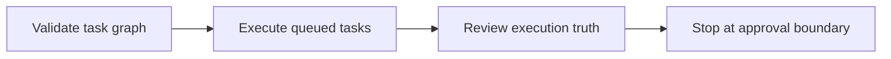
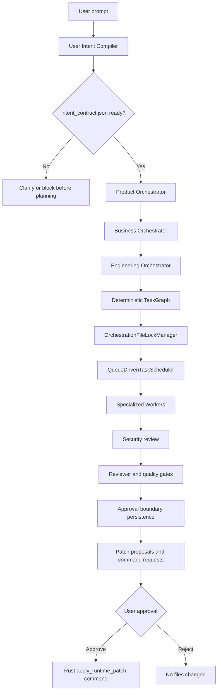

# Orchestration Flow

## Canonical Runtime Spine

New runtime orchestration work should plug into `CanonicalOrchestrationGraph`, a LangGraph-backed lifecycle in the TypeScript runtime. It is intentionally small:

The graph owns lifecycle shape only. It does not author semantic plans, call providers directly, apply patches, run shell commands, or bypass approval. Existing schedulers and workers plug in through services, and successful execution still stops at the Rust-mediated approval boundary before any workspace write.

Validation failure is a graph route, not a scheduler guard: malformed task graphs branch directly from `validate_graph` to `review_execution` and then `finalize`, so no scheduler or worker callback is invoked for invalid dependencies, duplicate task IDs, or cycles.

Use this spine for new orchestration ideas instead of adding another parallel scheduler/runtime path. Legacy swarm, recursive, campaign, and task-graph components should progressively become adapters around the same phases: validate, execute, review, approval boundary, final report.

`CanonicalTaskGraphBuilder` is the shared conversion and validation helper for adapter task graphs. New orchestration ideas should map their domain records into canonical task nodes with this helper, preserving unknown dependencies on the node so the shared validator and `CanonicalOrchestrationGraph` can block malformed graphs instead of silently dropping dependency truth.

Canonical task graphs have one dependency contract: every known `dependsOn` relationship must have a matching `edges` entry, and every dependency edge must be mirrored by the target node's `dependsOn`. Adapters should use `createCanonicalTaskGraph` and `validateCanonicalTaskGraph` instead of constructing or checking edges manually.

`CanonicalExecutionAdapter` is the shared adapter wrapper for scheduler-like execution paths. It runs `CanonicalOrchestrationGraph`, converts a domain scheduler result into `CanonicalTaskExecutionResult`, applies graph review rules, and returns canonical blocking reasons. Queue, swarm, recursive branch, campaign milestone, and legacy `TaskGraphManager` adapters use this wrapper so new orchestration ideas only need to supply domain-to-task-graph conversion, execution, and any domain-specific blockers.

`RuntimeDirectTurnService` owns the direct-answer lane that does not enter task orchestration. It records provider progress and decision-pipeline artifacts, completes provider-authored direct conversation turns, attaches evidence links, and keeps assistant messages behind provider request provenance. It does not plan tasks, call providers, run commands, apply patches, or cross the Rust authority boundary.

`RuntimeAdaptiveDirectTurnService` owns the provider-authored adaptive direct turn after the initial decision pipeline has routed the request. It runs `ReasoningKernel`, read-only escalation, command/patch proposal callbacks, and decision-pipeline finalization for direct conversation, workspace questions, provider refusals, and certified action-reasoning direct turns. `AgentRuntime` no longer owns tool registry setup, evidence-store creation, or direct-turn pipeline finalization.

`AgentRuntime` is a facade, not an answer author. It must not contain local evidence-answer builders, canned plan-confirmation prose, synthetic failure answers, or helper caches that can bypass the provider-authored direct-turn path.

`RuntimeConversationContextService` owns bounded same-session conversation packing for provider turns, including scoped-agent context projection and truncation metadata. `RuntimeTextUtils` owns deterministic language, provider-progress, and output-summary helpers shared by runtime services, so facade and orchestration services do not carry duplicate formatting logic.

`RuntimeProviderContextService` owns per-turn provider context creation. It builds the telemetry recorder, wraps the authoring provider, selects optional router/verifier model providers when the session config supplies them, and deliberately reuses the injected session provider when a runtime test or host owns provider construction. It does not call the provider, interpret intent, or create fallback answers; it only gives the turn one canonical provider context to pass into `ReasoningKernel`.

`RuntimeProviderGate` owns provider configuration errors and real-provider validation. Runtime session creation and real provider construction share this one gate, so mock/demo modes, missing configs, invalid provider settings, and missing API keys fail before any orchestration path can pretend to answer.

`RuntimeProviderFactory` owns concrete provider construction. `AgentRuntime` and specialized router/verifier model paths ask this boundary for real providers instead of importing provider implementations directly, keeping provider class selection beside the provider gate.

`RuntimeTurnFailureService` owns provider and runtime turn failure recording. It marks telemetry terminal failure, classifies provider-gate failures versus ordinary runtime failures, persists failure status/lifecycle/run-summary state, updates decision-pipeline failure metadata, and records a system failure message only when no assistant answer has been produced.

`RuntimeIntentContractService` owns the planning-entry intent contract gate for runtime sessions. It saves the original request in the intent ledger, runs `UserIntentCompiler`, records the resulting contract artifact/event/session fields, reuses an existing ready contract after clarification, and blocks planning with a clarification, blocked, or provider-failed status until a ready provider-authored contract exists.

`RuntimeApprovalBoundaryService` owns runtime-side recording at the approval/Rust boundary. It validates patch approvals, records patch rejection, records Rust apply start/success/failure acknowledgements, persists reconciliation and command-result artifacts, and records Rust command provenance. `AgentRuntime` still coordinates higher-level follow-ups such as recursive repair updates, branch projection, and final outcome sync after the boundary has recorded deterministic truth.

`RuntimeRunToGreenService` owns the bounded repair loop after Rust command and patch-apply truth is recorded. It advances selected command attempts, records conservative diagnoses and decision-ledger entries, proposes scoped repair patches through `ReasoningKernel`, queues rerun command requests after approved repair patches apply, and records repair-patch apply failures without applying files itself.

Patch-intent provider failure is terminal for that turn: invalid or missing provider patch intent blocks through the provider failure path instead of returning a local fallback warning contract or synthetic patch-unavailable result.

`RuntimeScopedAgentMessageService` owns scoped communication with runtime agents. Messages to live agents are recorded as steers without provider calls. Messages to completed agents produce read-only provider-authored replies through `ReasoningKernel` using persisted agent/session context, preserving provider request provenance and agent journal state without scheduling new work.

Agentic project-explain adapters are evidence/debug extension points only. They may return read plans, accepted evidence, trace data, and citations, but final user-facing prose still comes from the provider-backed project explanation path rather than local adapter markdown.

`RuntimeOrchestrationPreludeService` is the deterministic prelude before any planning-capable runtime handoff. It builds the project map, project intake, mode resolution, requested-agent count, think-first flag, and swarm mode input; it does not call providers or execute branches.

`RuntimeOrchestrationDispatchService` is the deterministic handoff after the prelude. It chooses the recursive swarm, recursive factory, ordinary provider-backed swarm, or simple run callback from the prelude result. The callbacks keep provider calls, branch execution, and approval authority in their existing services.

`RuntimePlanningTurnService` owns the planning-capable runtime turn after direct provider turns decline the request. It compiles the provider-authored intent contract, blocks before planning when the contract is not ready, builds the deterministic orchestration prelude, dispatches through the canonical runtime branch selector, and records the resolved execution mode. `AgentRuntime` no longer owns intent-contract planning gates or branch callback plumbing directly.

`RuntimePlanPendingActionService` handles plan-mode re-entry. It records plan clarifications, keeps clarified plans in `thinkFirst` mode, and clears `thinkFirst` only when the user confirms implementation. It does not apply patches, run commands, or create provider-authored prose.

`RuntimeRunEngineService` owns the compatibility handoff to the local `RunEngine` path. `AgentRuntime` routes to this service instead of constructing `RunEngine` directly, keeping simple/run-to-green/provider-backed-swarm handoff behavior behind one explicit execution boundary while the approval and Rust apply gates stay unchanged.

`RuntimeProviderBackedSwarmService` owns provider-backed read-only swarm execution and the optional handoff from read-only swarm preflight into `RuntimeRunEngineService` for gated write proposals. `AgentRuntime` routes to this service instead of owning swarm staffing/session projection/handoff mechanics directly.

`RuntimeRecursiveSwarmService` owns recursive swarm execution, recursive node progress events, edit-intent bridging into patch proposals or validation command requests, and recursive swarm session projection. `AgentRuntime` now dispatches to this service instead of constructing `RecursiveSwarmOrchestrator` or translating recursive tree state directly.

`RuntimeSessionOutcomeService` owns lifecycle synchronization after Rust patch/apply acknowledgements and command results. It builds verification truth, review-gate summaries, run phase state, module execution summaries, and final run summaries while `AgentRuntime` only invokes the service from approval/reporting entrypoints.

`RuntimeRecursiveBranchExecutionService` owns the recursive branch execution start gate: approval checks, Product Spec / Technical Plan / graph readiness validation, semantic-conflict review, initial branch execution record creation, and canonical recursive graph dispatch into the scheduler. `AgentRuntime` exposes the public entrypoint but no longer constructs branch execution records or runs the semantic-conflict resolver directly.

`RuntimePendingActionService` owns same-session re-entry for pending user decisions: request clarifications, product-spec clarifications, plan clarification/confirmation delegation, semantic-conflict resolution, and preview confirmation. It records locked clarifications through the intent ledger and creates preview command requests without bypassing Rust terminal authority.

`RuntimeRecursiveBranchProgressService` owns recursive projection after patch approval, Rust apply acknowledgement, and command results. It updates recursive repair state, projects patch status back onto branch execution records, advances the recursive scheduler when branch state changes, and refreshes fan-in reports. `AgentRuntime` no longer computes pending recursive validation patch IDs or refreshes fan-in directly.

`CanonicalQueueAdapter` is the ordinary orchestrated execution adapter. It runs `QueueDrivenTaskScheduler` through the canonical graph, preserves queue events for the runtime timeline, uses `OrchestrationFileLockManager` for workspace/directory/file locks, advances newly unblocked dependency tasks, and turns exhausted or unresolved queue failures into graph review blockers instead of leaving pending jobs behind.

Ordinary orchestration planning is isolated in `OrchestratedPlanningService`. It infers the project map when one is not supplied, then composes the product, business, and engineering orchestrators into briefs, assignment plan, work orders, and the task graph that enters the canonical queue adapter.

Ordinary orchestration planning persistence is isolated in `OrchestratedPlanningRecorder`. Planning generation stays separate from session mutation: the recorder writes product/business/engineering artifacts, task creation events, queued work statuses, and plan-mode confirmation state.

Ordinary orchestration session recording is isolated in `OrchestratedSessionRecorder`. It is the single runtime-facing surface for progress events, orchestration timeline events, queued work statuses, scheduler event replay, and orchestrator agent-run records. It does not plan, execute, review, apply patches, or call providers.

Ordinary queue execution is isolated in `OrchestratedQueueExecutionService`. It creates `QueueDrivenTaskScheduler`, runs the task graph through `CanonicalQueueAdapter`, captures worker outputs, preview recommendations, and lock snapshots, replays scheduler events, and closes queue resources. It depends only on `OrchestratedWorkerExecutionContracts`; concrete worker execution must be injected. If none is configured, the canonical queue blocks instead of producing local semantic worker output. It does not review output or cross the Rust patch/command authority boundary.

The old local generic worker executor is no longer part of the ordinary orchestration surface. Future worker implementations should satisfy `OrchestratedWorkerExecutionContracts` and be injected explicitly, preferably through provider-backed execution paths.

Ordinary orchestration review is isolated in `OrchestratedReviewService`. After the canonical queue graph returns execution truth, the service runs deterministic security checks, provider-backed adversarial reviewer review, bankruptcy findings, canonical graph blocking reasons, and deterministic quality gates. If the adversarial reviewer provider is missing, invalid, or errors, review blocks instead of creating fallback reviewer approval. `OrchestratedRuntime` persists those results and moves the session to the approval boundary or blocked state.

Ordinary orchestration approval-boundary persistence is isolated in `OrchestratedApprovalBoundaryService`. It records reviewed task state, worker outputs, review artifacts, quality gates, lock snapshots, preview recommendations, retry counts, and reasoning summaries; it does not apply patches or mark Rust-owned apply truth.

Ordinary orchestration final reporting is isolated in `OrchestratedFinalReportService`. It builds the durable run summary and final summary message from session patch proposals, command results, and quality gates; the runtime persists that report and still waits for Rust-mediated approval before any file write.

Ordinary orchestration completion is isolated in `OrchestratedCompletionService`. After queue execution, it wires review progress, approval-boundary persistence, validation/verification pending events, final report persistence, final progress, and completion/failure events. It delegates review and report construction to the focused services and keeps the runtime facade out of post-execution bookkeeping.

`OrchestratedRuntime` is the ordinary orchestration facade. It composes planning, planning recording, canonical queue execution, and completion services through explicit dependencies; new orchestration ideas should plug in at those service or canonical adapter boundaries instead of adding lifecycle logic to the facade.

`CanonicalSwarmAdapter` is the first compatibility adapter. It maps swarm `WorkItem` records into the canonical task graph, runs `SwarmScheduler` as the graph execution service, and translates blocked or failed swarm work back into graph review failures. The swarm report, metrics, events, and memory handoff still keep their existing public shape.

`CanonicalRecursiveAdapter` applies the same pattern to recursive factory branch execution. It maps `RecursiveBranchExecutionRecord` dependencies and lock scopes into a canonical task graph, validates that graph before branch execution starts, then delegates to the existing conservative recursive scheduler. Patch proposal, approval, Rust apply, and validation truth remain downstream authority boundaries.

Recursive factory planning is isolated in `RuntimeRecursiveFactoryPlanningService`. It handles Product Specification and Technical Plan proposal, revision, approval, artifact recording, and recursive graph proposal. This boundary stops before branch execution: no patches are proposed, no commands are requested, and no files are written until later execution services run through their approval and Rust authority gates.

Recursive swarm goal alignment, atomicity assessment, task splitting, node execution, and hierarchical collection merge prose are provider-required through `ReasoningKernel`. Missing or failing providers block the node with an auditable reason; local deterministic code may schedule queues, enforce dependencies, and preserve structural child-output traces, but it does not invent semantic goal checks, task decomposition, merged summaries, or prompt-only execution output.

`CanonicalCampaignAdapter` brings operator-driven campaigns onto the same spine. It maps campaign milestones into a sequential canonical task graph and lets `CampaignManager.runNext` execute the selected milestone through the existing `CoreOrchestrator` callback. Campaign persistence, CLI behavior, reports, metrics, and operator pause/resume semantics stay in `CampaignManager`.

`CanonicalTaskGraphManagerAdapter` is the compatibility bridge for the older `CoreOrchestrator` task loop. It maps `TaskGraphManager` tasks into the canonical task graph, runs the existing role invocation, lock, review, approval, repair, and validation logic as the execution service, and reports blocked or failed task state with per-task summaries through the shared graph review boundary.

`CoreTaskGraphCreationService` is the compatibility boundary for `CoreOrchestrator` task graph creation. It builds the deterministic scout/planner/executor/reporter graph, selects relevant files and validation commands, persists task-created events, and writes the task-decomposition artifact before execution enters the canonical TaskGraphManager adapter.

`CoreTaskGraphExecutionService` is the compatibility boundary for legacy `TaskGraphManager` execution. It routes the task graph through `CanonicalTaskGraphManagerAdapter` and the LangGraph lifecycle, then delegates ready-task locking, worker invocation callbacks, checkpoints, and status projection to the execution loop. `CoreOrchestrator` no longer owns the adapter-plus-loop plumbing directly.

The legacy execution loop and manager are intentionally not exported from the orchestration barrel. Tests and compatibility code may import them directly, but new runtime ideas should enter through canonical task graphs, queue/scheduler adapters, or focused core services.

`CoreRunLifecycleService` is the compatibility boundary for `CoreOrchestrator` run lifecycle work. It creates runs, seeds the original-request intent ledger, reconciles resume state against persisted artifacts and metadata, records accepted and rejected transitions, persists run status changes, writes checkpoints and metrics, and emits lifecycle events. The orchestrator calls lifecycle verbs instead of owning lifecycle persistence mechanics directly.

`CoreExecutorInvocationService` is the compatibility boundary for `CoreOrchestrator` ExecutorAgent work. It owns the executor queue enqueue/dequeue lifecycle, nested runtime session creation, configured-provider SeniorCodingAgent invocation, queue ack/nack, and summary normalization. `CoreOrchestrator` delegates to it instead of owning queue plumbing directly, which keeps future scheduler changes localized.

`CoreFinalReportArtifactSummaryService` is the compatibility boundary for legacy artifact-derived report counts. It reads prompt-writer and durable-lock artifacts, computes the final-report fields for those areas, and checks active durable locks without putting artifact parsing inside `CoreOrchestrator`.

`CoreFinalReportMetadataSummaryService` is the compatibility boundary for legacy metadata-derived report counts. It reads goal steward, team context, team sub-planning, team task adoption, proposed graph, execution-readiness, promotion, preparation, one-writer dry-run, patch-review, validation-candidate, patch sandbox apply, sandbox validation, sandbox integration-candidate, apply-approval, controlled-apply, and integration-finalization records through `FactoryMetadataStore`, leaving `CoreOrchestrator` to assemble the report instead of owning those repeated metadata queries.

`CoreFinalReportPolicy` is the compatibility boundary for legacy final-report decisions. It computes final run status from task, validation, and integration truth, and centralizes validation, integration, multi-plan, and provider-truth limitation text as pure policy helpers.

`CoreMemoryUpdateService` is the compatibility boundary for legacy durable memory handoff. It appends final run decisions, success patterns, or failed attempts through the SQLite-backed memory APIs and writes the matching memory-update trace events, while `CoreOrchestrator` only decides when the memory-update stage begins.

`CoreReportArtifactHelpers` keeps legacy final-report artifact parsing outside the orchestration facade. It provides optional JSON artifact reads, safe JSON record/array parsing, record narrowing, and team hierarchy summary formatting for report-summary builders.

`CoreStructuredOutputValidationService` is the compatibility boundary for legacy parsed-output validation. It validates and repairs provider-produced parsed outputs and generated patch proposals, records validation/repair artifacts, and persists role-specific derived outputs such as `ScoutResult` before patch safety and review gates run.

`CoreSafetyVerificationGateService` is the compatibility boundary for legacy post-worker safety and verification. It validates intent handoff, optionally runs semantic conflict resolution, records patch safety artifacts, runs deterministic review, applies approval gates, executes safe validation commands, and creates repair tasks without letting `CoreOrchestrator` own those gate mechanics directly.

`CoreFinalReportAssemblyService` is the compatibility boundary for legacy final-report assembly. It combines task and output truth, final intent review, report policy, artifact summaries, metadata summaries, integration status, and team hierarchy data into the persisted `FinalRunReport`, so the orchestrator facade no longer owns the long list of report field assignments.

`CoreOptionalExecutionPipelineService` is the compatibility boundary for optional legacy planning-to-integration stages. It owns execution preparation, one-writer dry-run, patch proposal review, validation candidates, patch sandbox apply, sandbox validation, integration candidates, apply approvals, controlled apply, and integration finalization skip/run chaining. `CoreOrchestrator` keeps compatibility wrappers for existing callers, but the gated pipeline mechanics now live in the service.

One-writer dry-run patch proposal generation is provider-required through `ReasoningKernel` when enabled. Runtime configuration accepts only `off`, `auto`, or `provider`; missing providers create blocked proposal artifacts instead of fake local patch output.

Patch proposal review is provider-required through `ReasoningKernel` when enabled. Runtime configuration accepts only `off`, `auto`, or `provider`; missing providers create blocked review artifacts instead of deterministic or fake local review output.

`CoreReadOnlyRoleInvocationService` is the compatibility boundary for legacy read-only role work. It invokes the configured provider through `ReasoningKernel`, records the raw provider output, normalizes the role result, and strips file-change claims. Missing providers now fail explicitly; the old deterministic role-prose fallback has been removed.

Recursive branch patch creation is isolated in `RecursiveBranchPatchProposalService`. The recursive scheduler selects the next branch or nested subtask, then delegates proposal recording to that service. The service may create `PatchProposal`s, diff artifacts, factory events, messages, and approval next-actions, but it does not write workspace files or mark Rust apply truth. This keeps new recursive orchestration strategies focused on scheduling decisions while sharing the same proposal and approval boundary.

Recursive branch scheduling is isolated in `RecursiveBranchSchedulerService`. It owns dependency waits, failed-dependency blocking, blocking conflicts, read-only branch completion, conservative single-writer selection, nested-subtask creation, and nested-subtask advancement while delegating branch and nested patch proposal recording to the proposal service.

Recursive branch patch status projection is isolated in `RecursiveBranchPatchStatusService`. When Rust or the UI reports a patch lifecycle state, the runtime delegates the branch/nested-subtask state update to this service, then runs the existing scheduler and fan-in follow-ups. This keeps approval/apply truth, branch state projection, scheduling, and final reporting as separate concepts.

Recursive branch validation is isolated in `RecursiveBranchValidationService`. It discovers candidate validation commands, chooses the deterministic validation strategy, reads existing Rust command evidence, and queues validation command requests when needed. The service records requests, tool intents, and verification artifacts, but Rust remains the only command execution authority and no verified pass is claimed without Rust-reported evidence.

Nested subtask rollup is shared through `RecursiveNestedRollup`. Recursive scheduling, patch projection, repair state, and fan-in reporting use the same nested validation truth rules instead of keeping separate copies.

Recursive repair state is isolated in `RecursiveRepairStateService`. Provider-authored repair patch generation remains gated through the existing provider path, while deterministic repair lifecycle updates live in the service: repair patch status tracking, repair revalidation command request creation, and revalidation result projection onto related branches.

Recursive repair planning is isolated in `RecursiveRepairPlanningService`. It turns failed recursive validation evidence and patch provenance into diagnosis, eligibility, and repair-attempt records, then delegates any eligible patch proposal to the provider-backed repair proposal service.

Recursive repair patch proposal generation is isolated in `RecursiveRepairPatchProposalService`. It calls the configured provider through `ReasoningKernel`, compiles the provider-authored repair intent into one reviewable patch proposal, enforces related-file scope, and records patch artifacts/tool intents without writing workspace files.

Recursive fan-in report building is isolated in `RecursiveFanInReportBuilders`. The builders derive branch results, branch validations, integration hierarchy, patch provenance, final validation, and final report records from deterministic session state; `AgentRuntime` only wires them into `RecursiveFanInReportService`.

Recursive fan-in reporting is isolated in `RecursiveFanInReportService`. It receives runtime-owned result builders and the provider-backed repair-loop callback, then persists branch results, integration summaries, validation hierarchy, final reports, repair diagnosis artifacts, lifecycle status, and fan-in events in one boundary.

## Steps

1. User selects Simple Agent or Multi-Agent Orchestrated mode.
2. Runtime creates a session in real provider mode.
   Same-session chat history is passed to `ReasoningKernel` as bounded provider context only; it is not durable memory, a semantic fallback, or an answer cache.
3. `UserIntentCompiler` writes `.agent_memory/.../intent/intent_contract.json`, `.md`, and append-only revisions before any planning-capable path starts.
4. Planning is blocked when the contract is missing, invalid, provider-unavailable, or has blocking missing questions. Non-blocking questions remain recorded as assumptions or risks.
5. Product Orchestrator emits `ProductBrief` from the ready contract, using `precise_rewrite` while preserving `original_user_request`.
6. Business Orchestrator emits `BusinessBrief`.
7. Engineering Orchestrator creates `TechnicalPlan` and `TaskGraph`.
8. `QueueDrivenTaskScheduler` runs dependency-ready tasks, releases newly unblocked downstream tasks after completion, and blocks tasks whose dependencies cannot resolve while `OrchestrationFileLockManager` prevents file conflicts.
9. Workers receive `AgentIntentInputFrame`: exact original prompt, ready intent contract, and current task slice.
10. Workers produce structured outputs with `intent_alignment`.
11. `IntentHandoffGate` blocks outputs not tied to the frame before dependencies, integration, patches, or commands can advance.
12. `OrchestratedReviewService` runs deterministic security checks, provider-backed reviewer review, bankruptcy findings, canonical graph blocking reasons, and deterministic quality gates over the worker outputs.
13. `OrchestratedApprovalBoundaryService` persists reviewed task state, worker outputs, quality gates, lock snapshots, retry counts, and reasoning summaries.
14. Runtime stops at approval with patch proposals and command requests still unapplied.
15. After approval, the desktop may call the Rust patch command to apply the reviewed diff.
16. The frontend reports the Rust apply result back to the runtime so lifecycle state can move to post-verify or failed.

## Events

The runtime emits orchestration events such as:

- `orchestration.started`
- `intent_contract.compiled`
- `product_brief.created`
- `business_brief.created`
- `technical_plan.created`
- `task.created`
- `task.started`
- `task.completed`
- `file_lock.acquired`
- `file_lock.released`
- `agent.completed`
- `intent_handoff_gate_passed`
- `intent_handoff_gate_blocked`
- `patch.reviewed`
- `security.reviewed`
- `orchestration.completed`

The desktop UI displays these events in the orchestration timeline.
